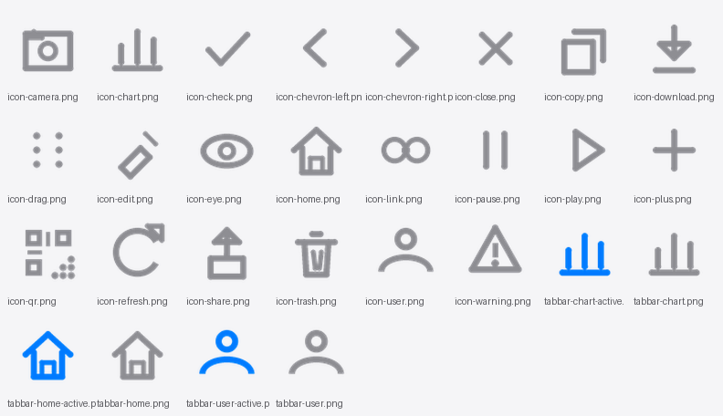

# GateLink 活码台

**一个码，背后挂多张二维码。按策略轮换展示，统计每条渠道的扫码效果。**

面向校园团长、本地商家、渠道代理的轻量活码工具。解决微信群二维码七天过期、满 200 人无法扫码，以及多条投放渠道无法区分效果的问题。


> **English**: A lightweight channel QR-code (活码) toolkit for WeChat. One printed QR points to a stack of merchant-owned QR images, rotated by pluggable strategies (round-robin / random / quota / weighted), with expiry-aware group-chat queueing, per-channel visit analytics and a shareable dashboard. Native WeChat Mini Program + a zero-framework Node.js backend.

---

## 这个项目解决什么问题

**问题一：群二维码会过期。** 微信群二维码 7 天失效、满 200 人后无法扫码加入。印在传单、易拉宝上的码一旦失效，物料全部作废。

**问题二：不知道哪个渠道有效。** 传单、海报、小红书、短视频各印一个码，事后分不清谁带来的量。

GateLink 的做法：对外只印**一个固定不变的码**，码的内容是一个普通 HTTPS 链接 `/c/<slug>`。商家在后台往这个 slug 后面挂多张二维码图片，系统按策略选一张展示，并记录这次访问来自哪条渠道、什么时段、什么设备。

换图、加群、下线某个客服，**都不用改动已经印出去的码**。

## 核心特性

| 能力 | 说明 |
|---|---|
| 多子码轮换 | 顺序 / 随机 / 配额 / 权重四种策略，可随时新增、暂停、重排 |
| 群码生命周期 | 每个子码可设过期时间与承接名额，到期或满员自动跳过 |
| 兜底机制 | 队列全部不可用时展示商家预留的客服码，不出现空白页 |
| 服务端出码 | 二维码由后端生成并下发，不依赖小程序原生能力，可嵌色、可下载 |
| 落地页可编辑 | 标题、主标题、副标题、正文、提示语、封面、主题色，商家自己排版 |
| 访问统计 | 访问量、独立访客、同比、趋势、时段分布、来源、子码分布、设备分布 |
| 分享看板 | 生成免登录链接给别人看数据，可设有效期、可随时关闭 |
| 列表预警 | 首页直接标出「无可用码 / 即将过期 / 名额将满」 |

**明确不做**：套餐计费、代理分销、团队子账号。先验证有没有人真的用，再谈商业化。

## 界面预览

设计系统与线框见 [`docs/02-ui-design.md`](docs/02-ui-design.md)，下面是自生产的图标集（29 个，全部代码绘制，无 emoji、无外部图标库）：



## 技术选型

| 层 | 选型 | 为什么 |
|---|---|---|
| 小程序 | 微信原生，无任何 UI 库 | 包体最小、启动最快、没有框架层损耗 |
| 后端 | Node.js 22 + 内置 `http` 模块 | 零 Web 框架依赖，减少安装与升级故障面 |
| 数据库 | SQLite（内置 `node:sqlite`） | 零安装、单文件、备份就是拷一个文件 |
| 二维码 | `qrcode` 包，PNG / SVG，带文件缓存 | 服务端出码，可换色、可下载 |
| 存储 | 本地目录 + nginx 静态分发 | 简单可控，后续可替换对象存储 |
| 部署 | 单机 + nginx 反代 + PM2 | 校园量级完全够用，边际成本接近零 |

整个后端只有 **1 个第三方依赖**（`qrcode`）。

## 架构

```
微信扫码
   │
   │ 码内容 = https://your.domain/c/<slug>
   ▼
┌──────────────────────────────────────┐
│  微信「扫普通链接二维码打开小程序」    │  ← 命中前缀规则则本地拉起小程序
│  未命中 / 未发布 → 直接打开 H5 兜底页  │
└──────────────────────────────────────┘
   │
   ▼
一次请求 /api/public/landing/:slug
   │  配置读取 + 子码决策 + 访问埋点，合并为一次
   ▼
渲染落地页（商家卡片 + 二维码大图）
   │
   ▼
用户长按识别，添加商家微信 / 进入群聊
```

商家后台（小程序管理端）通过 `/api/*` 管理活码、子码、统计与分享。

## 目录结构

```
gatelink/
├── miniprogram/              微信小程序（原生，无第三方库）
│   ├── pages/                6 个页面：index / editor / stats / profile / landing / share
│   ├── utils/                请求、鉴权、配置
│   └── assets/icons/         29 个自生产图标
├── server/                   Node.js 后端
│   ├── src/                  服务、数据库、路由、二维码、统计、上传
│   ├── tests/run.js          82 项自动化断言（起真实服务走完整 HTTP 链路）
│   └── .env.example          环境变量模板
├── tools/                    图标生成器、小程序静态检查
└── docs/                     规划、设计、测试、验收、项目档案
```

## 快速开始

### 后端

```bash
cd server
npm install
npm test      # 82 项自动化断言，会起临时服务跑完整链路
npm start     # 默认 http://127.0.0.1:8787
```

未配置微信凭证时自动进入 **DEV 模式**，登录返回临时账号，本地可以完整走通全部流程。

### 小程序

用微信开发者工具打开 `miniprogram` 目录：

1. 「详情 - 本地设置」勾选 **不校验合法域名**
2. 把 `miniprogram/utils/config.js` 的 `USE_DEV_SERVER` 改为 `true`，指向本地后端
3. 编译预览

## 配置

环境变量见 `server/.env.example`。Node 22 不会自动加载 `.env`，生产请用 PM2 / systemd / Docker 注入。

| 变量 | 说明 | 默认 |
|---|---|---|
| `PORT` | 监听端口 | `8787` |
| `PUBLIC_HOST` | 对外域名，二维码内容与分享链接基于它生成 | `https://gate.example.com` |
| `WX_APPID` / `WX_SECRET` | 小程序凭证，留空则进入 DEV 模式 | 空 |
| `TOKEN_SECRET` | 登录 token 签名密钥，**生产必须修改** | 本地默认值 |
| `VISITOR_SALT` | 访客指纹哈希盐，**生产必须修改** | 本地默认值 |
| `DB_FILE` / `UPLOAD_DIR` / `QR_DIR` | 数据、上传、二维码缓存目录 | `server/data` 下 |
| `MAX_UPLOAD_BYTES` | 单次上传上限 | 5 MB |

## 部署

1. 服务器安装 **Node ≥ 22.5**
2. `npm install --omit=dev`
3. `pm2 start src/index.js --name gatelink --node-args="--experimental-sqlite"`
4. nginx 反代 `/api`、`/static`、`/c`、`/s` 到 `8787`
5. 配置 HTTPS 证书
6. 定时备份 `data/gatelink.db`

上线前还有一批**只能在微信公众平台手动完成**的操作（AppID、request 合法域名、扫码跳转规则、备案、隐私指引、类目），逐项列在 [`docs/05-project-record.md`](docs/05-project-record.md) 第六节。

## 接口一览

21 个 REST 接口 + 2 个 H5 页面路由。商家接口带 `Authorization: Bearer <token>`，公开接口免鉴权。

| 分组 | 主要接口 |
|---|---|
| 鉴权 | `POST /api/auth/login`、`GET /api/me` |
| 活码 | `GET/POST /api/campaigns`、`GET/PATCH/DELETE /api/campaigns/:id`、`POST .../duplicate` |
| 子码 | `POST /api/campaigns/:id/channels`、`PATCH/DELETE /api/channels/:id`、`POST .../channels/reorder`、`POST /api/channels/:id/image` |
| 二维码 | `GET /api/campaigns/:id/qrcode?format=png\|svg&size=512` |
| 统计 | `GET /api/campaigns/:id/stats?range=today\|7d\|30d` |
| 分享 | `POST /api/campaigns/:id/share`、`GET .../shares`、`DELETE /api/share/:token` |
| 公开 | `GET /api/public/landing/:slug`、`GET /api/public/share/:token` |
| 页面 | `GET /c/:slug`（H5 落地页）、`GET /s/:token`（H5 分享看板） |

完整参数与返回结构见 [`docs/01-plan.md`](docs/01-plan.md) 第五节。

## 几个关键设计取舍

**二维码由服务端生成，不用小程序原生码。** 因为对外物料上的码内容必须是一个普通 HTTPS 链接——这样微信「扫普通链接二维码打开小程序」能接管它，直接打开也能落到 H5 兜底页，**一个码两个出口，不用写切换逻辑**。小程序原生码做不到这一点。

**落地页只发一次请求。** 配置读取、子码决策、访问埋点合并成一个接口；二次打开读本地缓存，先渲染再后台刷新。

**访客指纹不存原始 IP。** `sha256(ip + ua + salt)` 单向哈希，只用于估算独立访客，不留可回溯的原始地址。

**后端不用 Web 框架。** 路由是一张正则表，静态文件、multipart 解析手写。代价是代码量，收益是没有 `npm audit` 焦虑、没有框架升级迁移、单文件部署。

## 合规边界

这部分是这个项目能不能活下去的前提，写在最前面：

| 可以做 | 明令禁止 |
|---|---|
| 统计落地页访问量、独立访客、时段、地域 | 声称能识别用户是否成功添加好友 |
| 按策略轮换展示商家上传的二维码 | 代用户操作微信、Hook、机器人、逆向接口 |
| 给商家导出物料 | 收集访客昵称、头像、通讯录、聊天记录 |
| 提醒群码即将过期或满员 | 承诺「绕过微信限制」「防封防红」 |

**没有任何官方能力能告诉你"这个人加没加上好友"**，个人微信不存在带参二维码。所有宣称能自动识别好友来源的方案，底层都是非官方协议或逆向接口。这个项目不做，也不假装能做。

对外文案同理：写「统计扫码访问」，不写「自动识别来源」；写「展示商家提供的二维码」，不写「保证成功添加」。

## 现状

**首版代码已完成并通过三轮自测，但尚未上线。**

- 后端 82 项自动化断言全通过（起真实服务走 HTTP，不是 mock）
- 小程序主包 141 KB，预算 300 KB
- 真机渲染、真实 `wx.login`、相册授权、iOS/Android 机型适配**未验证**，见 [`docs/04-acceptance.md`](docs/04-acceptance.md)

已知待办：图片压缩、微信内容安全 API、孤儿文件清理、二维码嵌 Logo、`node:sqlite` 长期稳定性评估。

## 参与贡献

欢迎提 Issue 和 PR。提交前请先跑：

```bash
cd server && npm test
node tools/check-miniprogram.js
```

两个都必须全绿。

## 许可证

[MIT](LICENSE)
